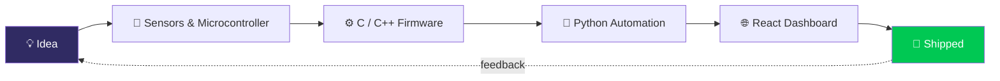

<!-- HEADER -->
<p align="center">
  
</p>

<p align="center">
  <a href="https://github.com/m4rtin004">
    
  </a>
</p>

<p align="center">
  
  
  
</p>

---

## 👾 `whoami`

```java
public class Martin extends SoftwareEngineer implements HardwareHacker, Automator {

    private final String university = "Universiteti Metropolitan Tirana";
    private final String location   = "Tirana, Albania 🇦🇱";

    private final String[] languages = {"Java", "Python", "C", "C++", "JavaScript"};
    private final String[] playground = {"Arduino", "Raspberry Pi", "E-Scooters", "Car Tuning"};

    public String currentMission() {
        return "Building robust software & breaking hardware (on purpose).";
    }

    public String funFact() {
        return "If it has a microcontroller, I'll try to modify it.";
    }
}
```

---

## 🛠️ Tech Arsenal

<p align="center">
  
</p>

<details>
<summary><b>📂 Full stack breakdown (click to expand)</b></summary>
<br>

| Domain | Stack |
|---|---|
| 🧠 **Languages** | Java (OOP), Python, C, C++, JavaScript, Ren'Py |
| 🌐 **Frontend** | React, Tailwind CSS |
| 🔌 **Embedded & Hardware** | Raspberry Pi, Arduino, microcontrollers, L298N motor drivers, sensor integration |
| 🧰 **Tools** | Git, GitHub, VS Code, Eclipse IDE, PowerShell, MSYS2/MinGW, Linux |
| 🎓 **Academic Core** | OOP, Computer Architecture, Digital Logic, Discrete Math, Calculus |

</details>

---

## 🔌 Hardware Lab → Software Pipeline



---

## 📊 GitHub Command Center

<p align="center">
  
  
</p>

<p align="center">
  
</p>

<p align="center">
  
</p>

### 📈 Contribution Graph

<p align="center">
  
</p>

### 🐍 Snake eating my commits

<p align="center">
  
</p>

> The snake needs the GitHub Action included in `.github/workflows/snake.yml` — see setup steps below.

---

## 🚀 Featured Projects

<!-- Replace repo names below with your real repositories -->
<p align="center">
  <a href="https://github.com/m4rtin004/blackjack"></a>
  <a href="https://github.com/m4rtin004/classic-shopping-web"></a>
</p>
<p align="center">
  <a href="https://github.com/m4rtin004/3d-ball-game-using-physics"></a>
</p>

---

## 🎯 Currently

| | |
|---|---|
| 🔭 **Learning** | Computer Architecture, Digital Logic, advanced Java |
| 🛠️ **Building** | Embedded projects with Arduino / Raspberry Pi |
| 🤝 **Looking for** | Collabs on software, automation & hardware projects |
| 💬 **Ask me about** | Java, C/C++, microcontrollers, e-scooter mods, car tuning |

---

## 🎲 Dev Joke of the Refresh

<p align="center">
  
</p>

<p align="center">
  
</p>

---

## 📫 Let's Connect

<p align="center">
  <a href="https://github.com/m4rtin004"></a>
  <a href="https://www.linkedin.com/in/martin-shytllari-ag047"></a>
  <a href="mailto:martin1shytllari@gmail.com"></a>
</p>

<p align="center">
  
</p>
